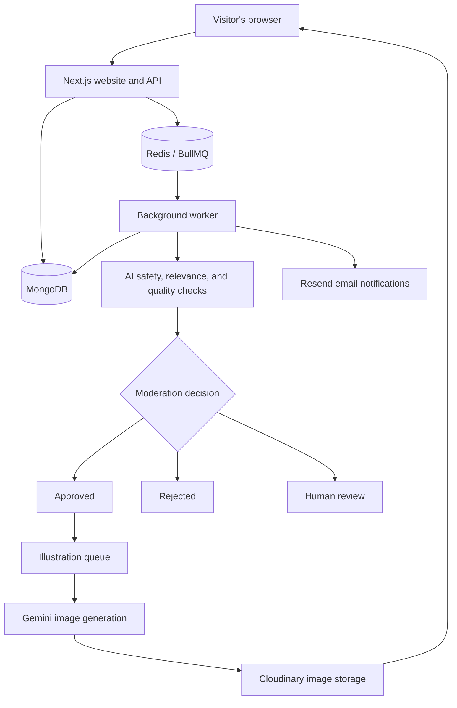

# Heart Witness

**Some moments deserve to be remembered.**

Heart Witness is a community storytelling website for real, personal stories of love, respect, gratitude, and kindness. People can share a meaningful moment in **50–500 words**, discover stories by theme, and pass them on to others.

The application combines a full-stack Next.js website with background processing for AI-assisted moderation and story illustrations. Submitted stories are reviewed before they appear publicly.

## What you can do

- **Read and explore:** browse published stories and filter by love, respect, gratitude, or kindness.
- **Share a story:** submit as a guest or through an account, with the option to publish under “Anonymous.”
- **Manage your stories:** signed-in authors can track review status and edit/resubmit rejected stories.
- **Respond to stories:** react with gratitude, respect, love, or applause; story pages also track reads.
- **Share with others:** use WhatsApp, Facebook, LinkedIn, X, native device sharing where supported, or Copy link. Published stories have their own social-preview metadata.
- **Review submissions:** administrators can approve or reject stories that need human review and request new illustrations.

The interface uses warm paper tones, serif storytelling typography, and a heart-and-book brand mark. Approved stories can receive graphite-style AI illustrations.

## How it works



The web app and API live in the same repository and run as one Next.js service. Server-rendered pages can read MongoDB directly; browser interactions use API routes. A separate worker process handles moderation and illustration queues so these tasks do not block submission requests.

### A story's journey

1. The API validates a submission and saves it as `pending` in MongoDB.
2. A BullMQ job runs checks for safety, theme relevance, and quality.
3. Decision rules approve the story, reject it, or send it for human review. Automated review errors are routed to human review.
4. Approved stories become public, and a separate job generates an illustration and uploads it to Cloudinary.
5. When email is enabled, the worker attempts to notify signed-in authors when a story is approved or rejected.

Story status and illustration status are separate. A published story can be read while its image is still being prepared. Guest submissions are not attached to an account and do not appear in an account's story history.

## Technology

| Area | Technology |
| --- | --- |
| Website and API | Next.js 15 App Router, React 18, TypeScript |
| Styling | Tailwind CSS 3, Lora, DM Sans |
| Authentication | NextAuth credentials provider, JWT sessions, bcrypt password hashing |
| Database | MongoDB with Mongoose |
| Validation | Zod |
| Background jobs | BullMQ and Redis through ioredis |
| Text moderation and scene descriptions | Anthropic Claude or Google Gemini |
| Illustration generation | Google Gemini |
| Image hosting | Cloudinary |
| Email | Resend |
| Release automation | GitHub Actions, Vercel CLI, Render API |

Email/password login is implemented. Google, Facebook, and Instagram login are not currently integrated; social-sharing buttons do not authenticate visitors.

## Run locally

### Requirements

- **Node.js 22.x** and npm; the expected version is recorded in `.nvmrc`.
- A running MongoDB instance and Redis instance, local or hosted.
- API credentials for the services you want to exercise. Full moderation/illustration/email processing requires the worker's provider credentials.

### 1. Install dependencies

```sh
git clone https://github.com/Venu-Works/echoes_of_kidness.git
cd echoes_of_kidness
npm ci
```

### 2. Configure the environment

For a new checkout, copy [`.env.example`](.env.example) to `.env.local` and fill in your values. Keep your existing `.env.local` if you already have one configured.

Set these for the local web app:

```dotenv
MONGODB_URI=mongodb://127.0.0.1:27017/heart-witness
REDIS_URL=redis://127.0.0.1:6379
SITE_URL=http://localhost:3000
NEXTAUTH_URL=http://localhost:3000
NEXTAUTH_SECRET=<generated-secret>
ADMIN_EMAILS=<your-admin-account-email>
```

Generate an authentication secret with:

```sh
node -e "console.log(require('crypto').randomBytes(32).toString('base64'))"
```

For the worker, also configure:

- `AI_PROVIDER`: `claude` (default) or `gemini`.
- `ANTHROPIC_API_KEY` when using Claude for text processing.
- `GEMINI_API_KEY` for illustrations, and for text processing when Gemini is selected.
- `CLOUDINARY_CLOUD_NAME`, `CLOUDINARY_API_KEY`, and `CLOUDINARY_API_SECRET`.
- For email notifications, `RESEND_API_KEY` and `EMAIL_FROM`, using a sender domain verified in Resend. To defer email setup, set `EMAIL_ENABLED=false`; moderation and illustrations still run, and authors check status on the website.

Optional settings include `GEMINI_IMAGE_MODEL`, `MODERATION_CONCURRENCY`, and `ILLUSTRATION_CONCURRENCY`. See the [full environment-variable reference](DEPLOYMENT.md#environment-variables) for details.

`.env.local` is ignored by Git. Configure hosted secrets through the hosting dashboards rather than committing them.

### 3. Start the website

```sh
npm run dev
```

Open **[http://localhost:3000](http://localhost:3000)**.

### 4. Start the worker in another terminal

```sh
npm run worker
```

The web app and worker must use the same MongoDB and Redis instances. Without a worker, submissions can be saved and queued, but automated review and image generation will not proceed. Running the full pipeline makes real provider requests and may consume paid quotas.

To access the review queue, register/sign in with an account whose email appears in `ADMIN_EMAILS`.

## Useful commands

| Command | Purpose |
| --- | --- |
| `npm run dev` | Start the local Next.js development server |
| `npm run worker` | Start moderation and illustration consumers |
| `npm run build` | Build the production website |
| `npm start` | Serve an existing production build |
| `npm run lint` | Check code with ESLint |
| `npm run typecheck` | Check TypeScript types |
| `npm test` | Run configuration and release-workflow tests |
| `npm run env:check -- --production` | Validate production web settings without printing secret values |
| `npm run env:check -- --worker --production` | Validate production worker settings |
| `npm run queue:recover` | Dry-run inspection of pending stories missing moderation jobs |
| `npm run queue:recover -- --apply` | Queue eligible pending stories for moderation |
| `npm run backfill-images` | Queue illustrations for approved stories missing images |

Recovery and backfill commands require database/Redis access. Commands that enqueue work can trigger paid AI processing. See [recovery instructions](DEPLOYMENT.md#recover-pending-moderation) before using them in production.

Development output is stored in `.next-dev`; production builds use `.next`, preventing build commands from overwriting a running development server's output.

## Project structure

```text
app/                         Pages, layouts, metadata, and API routes
  (auth)/login/              Email/password login and registration
  api/                       Story, auth, engagement, admin, and health endpoints
  admin/                     Human review interface
  edit/[id]/                 Author resubmission page
  profile/                   Signed-in author's story history
  stories/                   Story listing and individual story pages
  submit/                    Story submission page
components/                  Shared interface components and forms
lib/
  agents/                    Safety, relevance, quality, and decision rules
  ai/                        Text generation and illustration integration
  queue/                     BullMQ queues, job IDs, and worker entry point
  auth.ts                    Authentication and admin session configuration
  mongodb.ts                 Cached database connection
  rateLimit.ts               Redis-backed production submission limits
models/                      User, story, reaction, and moderation-log schemas
scripts/                     Environment checks, recovery, and deployment utilities
tests/                       Configuration and release tests
.github/workflows/           Validation and tag-triggered production release
```

## Main routes

| Route | Purpose |
| --- | --- |
| `/` | Homepage and recent stories |
| `/stories` | Browse and filter published stories |
| `/stories/[id]` | Read, react to, and share a published story |
| `/submit` | Submit a story |
| `/login` | Sign in or create an account |
| `/profile` | View your submissions and their review status |
| `/admin` | Administrator review queue |
| `/api/health` | Application liveness check; does not test database or queue readiness |

API routes cover story listing/submission, author edits, reads, reactions, registration, authentication, and administrator review/image generation. They are implemented under [`app/api`](app/api).

## Deployment and release control

The prepared hosting setup uses **Vercel for the web app**, **Render for the worker**, and managed MongoDB/Redis. Both services use the same production data and job queues. A custom domain such as `heart-witness.com` can be connected after the initial host setup; `SITE_URL` and `NEXTAUTH_URL` must match the canonical web origin.

**Production releases are triggered by version tags, not ordinary branch pushes.** The release workflow accepts stable tags such as `v1.0.0` pointing to a commit on `main`. It runs validation and a production build, deploys the exact tagged worker commit, waits for it to become live, and then deploys the web app.

After the workflow is committed and the hosting accounts, application settings, and GitHub production secrets are configured, the project owner creates the release:

```sh
git tag -a v1.0.0 -m "Release v1.0.0"
git push origin v1.0.0
```

Creating a local tag alone does not deploy anything. The workflow requires `VERCEL_TOKEN`, `VERCEL_ORG_ID`, `VERCEL_PROJECT_ID`, `RENDER_API_KEY`, and `RENDER_SERVICE_ID` in the GitHub `production` environment. Direct Git deployments are disabled in the host configs; existing host settings must also be configured as described in the guide.

Web and worker deployments are not atomic across hosts. Keep database and queue changes backward compatible, and inspect both services if a release fails.

See **[DEPLOYMENT.md](DEPLOYMENT.md)** for account setup, environment variables, tag restrictions, monitoring, recovery, and rollback. The configuration files prepare deployment; they do not provision hosting accounts, secrets, or DNS automatically.

## Current safeguards and next milestone

- Stories are validated and moderated before publication.
- Administrator routes check the signed-in user's configured admin email.
- Production submissions/resubmissions are rate-limited through Redis. New submissions use an account-based limit for signed-in users or an IP-based limit for guests.
- Moderation job IDs include the submission revision so recovery can deduplicate jobs.
- Worker shutdown handlers let active jobs finish, and moderation updates avoid overwriting an administrator's decision made during processing.

Additional automated-submission protection is a **subsequent milestone**: bot verification, combined account/IP limits, duplicate detection, and AI-processing budgets are not yet implemented. Email verification and social login are also not currently implemented.

## Further reading

- [Deployment and operations](DEPLOYMENT.md)
- [Social sharing setup and verification](SOCIAL_SHARING.md)
- [Environment template](.env.example)
- [Original project plan](PROJECT_PLAN.md) — planning context; the current code and operational guides describe implemented behavior.
